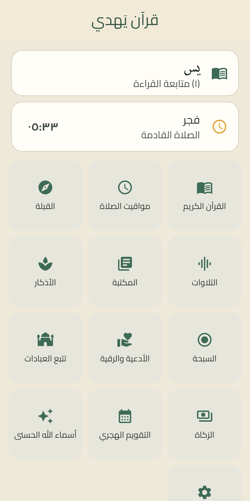
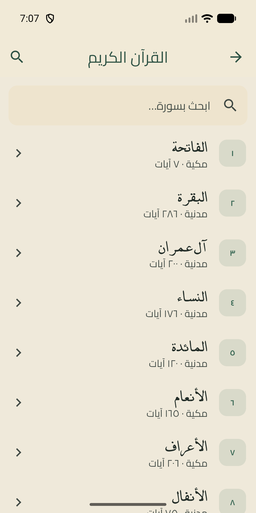
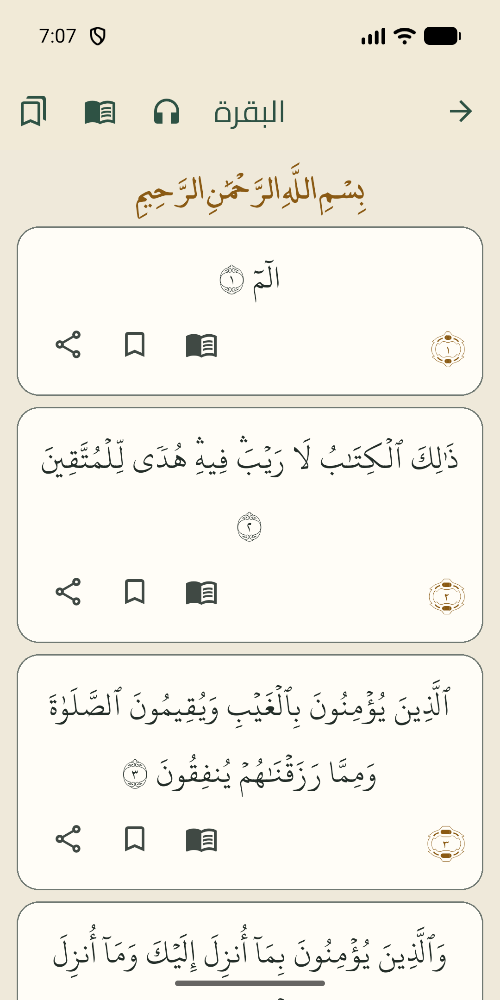
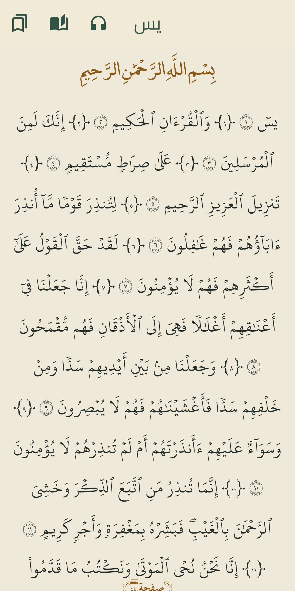
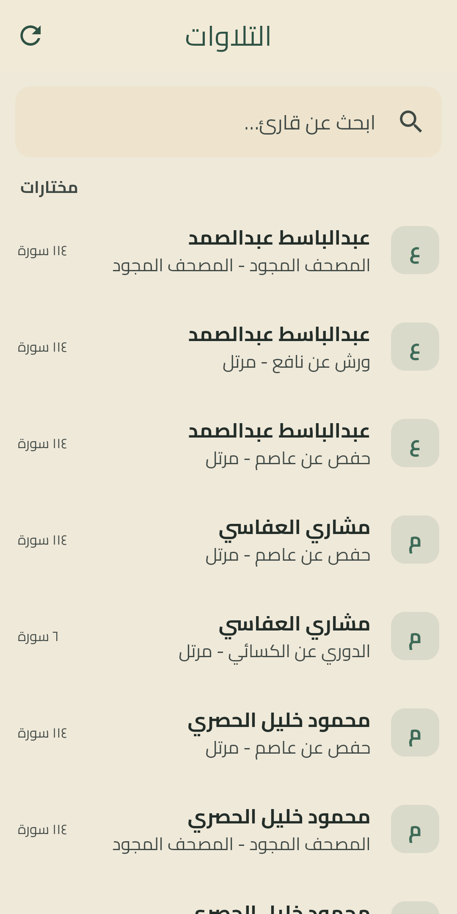
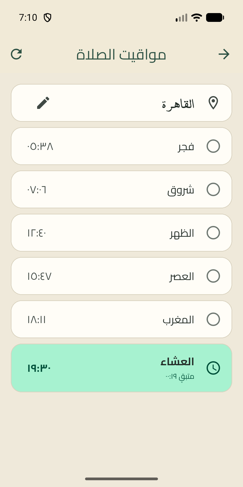

# قرآن يَهدي — Quran Yahdi

رفيق إسلامي متكامل يعمل **بلا إنترنت أولًا**: مصحف كامل (114 سورة، 6236 آية) مضمّن داخل التطبيق، تلاوات صوتية تُبث أو تُنزَّل، أذكار وأدعية، مواقيت الصلاة والقبلة — بلا حسابات ولا إعلانات ولا تتبع. عربي أولًا مع الوضع الليلي.

Quran Yahdi is a complete, offline-first Quran companion for Android: the full Mushaf bundled on-device, audio recitations you can stream or download, adhkar, duas, prayer times and a live Qibla compass — with no accounts, no ads, and no data collection.

> **الحالة الحالية (بأمانة):** MVP أندرويد مكتمل (v1.0.0 قيد التحضير للمتجر) · رفع iOS ومسودة عرض المتجر قيد التنفيذ — انظر `docs/store/` و`PRIVACY.md`.

## الميزات (إصدار v1)

| # | الميزة | الوصف |
|---|---|---|
| 1 | الرئيسية | بطاقة الصلاة القادمة + متابعة القراءة + شبكة الميزات |
| 2 | فهرس السور | 114 سورة مع بحث فوري بالاسم أو الرقم |
| 3 | قارئ القرآن | قراءة آية-بآية أو وضع المصحف الصفحي التقليدي |
| 4 | شاشة الآية | التفسير والترجمات وعلامة الحفظ من مكان واحد |
| 5 | متابعة القراءة | حفظ آخر موضع وعلامات مرجعية متعددة |
| 6 | التلاوات | أكثر من 240 قارئًا (خدمة mp3quran) — بث فوري أو تحميل كامل للأوفلاين |
| 7 | المشغّل والتنزيلات | مشغّل مصغّر يلازمك + مدير تنزيلات بحالة كل ملف |
| 8 | مواقيت الصلاة | أوقات دقيقة لاختيار مدينتك (أو أقرب مدينة تحديدًا على جهازك) + تنبيه صلاة اختياري |
| 9 | القبلة | بوصلة بتوجيه حي من حساسات الهاتف |
| 10 | الأذكار | أذكار مصنّفة مع عدّاد لكل ذكر |
| 11 | السبحة | عدّاد إلكتروني دائري بأهداف قابلة للتبديل |
| 12 | الأدعية والرقية | مختارات مرتبة من المصنفات التقليدية مع آيات النصوص |
| 13 | متتبع العبادات | الصلوات الخمس اليومية وخطط الختمة |
| 14 | الإعدادات والإضافات | وضع ليلي، حساب الزكاة، التقويم الهجري، أسماء الله الحسنى |

## لقطات الشاشات

يُرفق المالك صور PNG حقيقية لاحقًا (المسودة وقائمة اللقطات في `docs/store/listing-ar.md` و`docs/store/listing-en.md`، والمستهدفات تحت `docs/store/screenshots/`):








<!-- PLACEHOLDER LINKS — الملفات أعلاه غير موجودة بعد؛ تُستبدل عند إرفاق اللقطات -->

## التقنيات

Flutter · Dart ·
**flutter_bloc** (إدارة الحالة) · **drift** (قاعدة بيانات محلية: النص، القُرّاء، الحِزم، التتبع) ·
**go_router** · **just_audio** + **just_audio_background** (تشغيل التلاوات) · **adhan** (حساب المواقيت) ·
**geolocator** (أقرب مدينة — المعالجة على الجهاز فقط) · **dio** (تنزيلات) ·
**flutter_local_notifications** + **timezone** (التنبيهات) · **hijri** ·
**freezed / build_runner** · **get_it** — ببنية كود مميزة Feature-first.

## البناء والاختبار

```bash
flutter pub get
flutter gen-l10n
dart run build_runner build --delete-conflicting-outputs

flutter analyze        # بوابة الحملة: 0 مشكلات
flutter test           # البوابة الكاملة: 620 اختبار

flutter build apk --debug          # للتثبيت السريع على جهاز
flutter build appbundle --release  # مخرجات المتجر
flutter build apk --split-per-abi  # APK مباشر أصغر حجمًا لكل معمارية (الافتراضي يبقى AAB أعلاه)
tools/device_smoke.ps1             # بوابة دخان الجهاز: تثبيت + إقلاع بلا أخطاء قاتلة
```

التوقيع عند الإصدار: إن وُجد `android/key.properties` (مستثنى من Git) وُقّعت المخرجات منه، وإلا يبنى التطبيق موقّعًا بـ debug مع تنبيه صريح في السجل حتى يستلم المالك مفتاحه (W7c).

## المحتوى والمصادر

- نص القرآن الكريم (رواية حفص، نص عثماني وإملائي): مضمّن محليًا داخل التطبيق.
- الأذكار والأدعية والرقية: تجميعات من المصنفات التقليدية المتداولة.
- التلاوات الصوتية: من خدمة mp3quran.net المجانية.
- الخطوط: Cairo برخصة SIL OFL (النص مرفق في `assets/fonts/Cairo-OFL.txt`) + خطا المصحف HafsSmart وme_quran بشروط نشر مجانية من ناشر المصحف.
- التفاصيل الكاملة في `PRIVACY.md`.

## الرخصة

الكود: جميع الحقوق محفوظة لصاحب المشروع (مشروع بورتفوليو). محتوى التطبيق مفتوح المصدر وفق رخص المحتوى المذكورة أعلاه.
